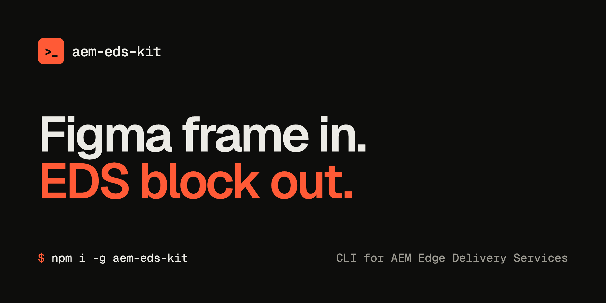
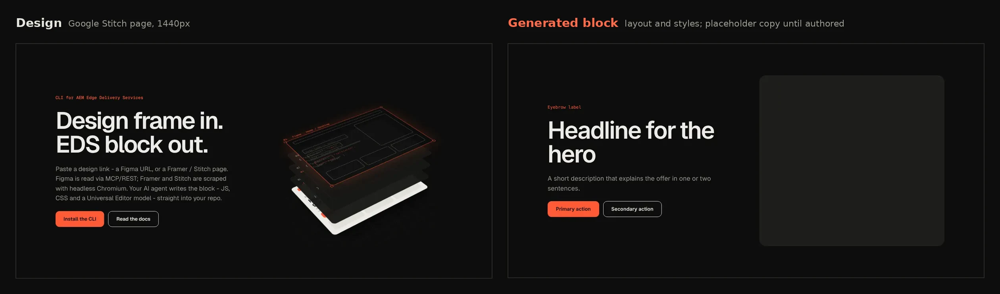

<p align="center"></p>

# aem-eds-kit

[](https://www.npmjs.com/package/aem-eds-kit)
[](https://www.npmjs.com/package/aem-eds-kit)
[](https://github.com/piotrgodycki/aem-eds-kit/actions/workflows/ci.yml)
[](https://github.com/piotrgodycki/aem-eds-kit/blob/main/LICENSE)
[](https://nodejs.org)

**[Docs](https://piotrgodycki.github.io/aem-eds-kit/docs.html)** · **[Changelog](https://piotrgodycki.github.io/aem-eds-kit/changelog.html)** · **[End-to-end test](https://piotrgodycki.github.io/aem-eds-kit/e2e-example.html)** · **[Issues](https://github.com/piotrgodycki/aem-eds-kit/issues)**

**The agent harness for AEM Edge Delivery: your AI agent turns a design into a block, inside guardrails.** `eds` builds the agent's task, limits what it may touch (Claude Code writes only the block's folder), runs it, checks what it wrote and runs the rounds of changes. It turns a Figma frame, a Framer / Stitch page or any web page into an AEM Edge Delivery block (JS, CSS, Universal Editor model) with the AI agent you already use: Claude Code, Cursor, Codex, or a local model (Ollama, oMLX). It also creates projects, migrates AEM components, previews, tests, tracks and publishes. It runs next to `@adobe/aem-cli` and adds nothing to your site's payload.

<p align="center"></p>

## Install

```bash
npm install -g aem-eds-kit     # Node 20+
```

## Quick start

```bash
eds new my-site && cd my-site                      # the latest Adobe boilerplate
eds block from-design --sample --name hero         # try it: no Figma, no token
eds block from-design "<design link>" --name hero  # design → blocks/hero/
eds block preview hero                             # see it live
eds                                                # interactive menu
```

## Commands

Every command has `--help`; the full reference is on the **[docs page](https://piotrgodycki.github.io/aem-eds-kit/docs.html)**.

| Command | Does |
|---|---|
| [`eds new`](https://piotrgodycki.github.io/aem-eds-kit/docs.html#new) · [`init`](https://piotrgodycki.github.io/aem-eds-kit/docs.html#init) | Clone the boilerplate (DA, UE, Commerce); set it up |
| [`eds block from-design`](https://piotrgodycki.github.io/aem-eds-kit/docs.html#from-design) | A design link or export → a block, by your agent |
| [`eds draft`](https://piotrgodycki.github.io/aem-eds-kit/docs.html#draft) | Review rounds before a block reaches the repo |
| [`eds block create` · `list` · `preview`](https://piotrgodycki.github.io/aem-eds-kit/docs.html#create) | New empty block, list, live preview |
| [`eds block test` · `check`](https://piotrgodycki.github.io/aem-eds-kit/docs.html#block-test) | Visual regression, content and a11y checks |
| [`eds migrate component`](https://piotrgodycki.github.io/aem-eds-kit/docs.html#migrate) | Classic AEM component → block + UE model |
| [`eds model` · `schema` · `ue`](https://piotrgodycki.github.io/aem-eds-kit/docs.html#model) | UE models, JSON-LD, Universal Editor helpers |
| [`eds track block` · `page`](https://piotrgodycki.github.io/aem-eds-kit/docs.html#track) | Analytics: block events; every part of the page, any data layers |
| [`eds scaffold` · `integrate`](https://piotrgodycki.github.io/aem-eds-kit/docs.html#scaffold-ue) | UE config, helpers, CI; GTM, GA4, consent, chat |
| [`eds template` · `sandbox`](https://piotrgodycki.github.io/aem-eds-kit/docs.html#template) | Pages from blocks; disposable sandbox repos |
| [`eds preview` · `publish`](https://piotrgodycki.github.io/aem-eds-kit/docs.html#admin) | AEM Admin API |
| [`eds doctor` · `audit` · `agents`](https://piotrgodycki.github.io/aem-eds-kit/docs.html#doctor) | Project checks, loading and security audits, agent status |
| [`eds figma setup`](https://piotrgodycki.github.io/aem-eds-kit/docs.html#figma-setup) | Connect your agent to Figma MCP |

`--json` on `block from-design`, `draft` and `agents` prints one event per line, for tools.

## Desktop app

**[AEM EDS Studio](https://github.com/piotrgodycki/aem-eds-studio)** is the desktop app on top of this CLI (macOS, Windows): review drafts on three devices, accept onto a branch, a work board. Download it from the [site](https://piotrgodycki.github.io/aem-eds-kit/#studio). New capabilities land here first.

## Tech stack

| | |
|---|---|
| Language | TypeScript (ESM), Node.js 20+ |
| CLI | Commander, Inquirer, chalk, ora |
| Processes | execa (agents, git) |
| Validation | Zod |
| Parsing | yaml, fast-xml-parser (AEM dialogs) |
| Browser (optional) | Playwright / headless Chromium: scraping, preview, visual tests; pixelmatch, pngjs |
| Figma | REST API, Model Context Protocol SDK (optional) |
| Build, test, lint | tsup, Vitest, Biome |
| CI / release | GitHub Actions; npm with provenance (OIDC), GitHub Packages; site on GitHub Pages |

## Development

```bash
npm install
npm run dev -- doctor          # run from source
npm run lint && npm run typecheck && npm test && npm run build
npm run build && npm link      # `eds` from this checkout
```

Merging a new version to `main` releases it (npm, GitHub Packages, tag, release notes). See [CONTRIBUTING rules](https://github.com/piotrgodycki/aem-eds-kit/blob/main/CLAUDE.md).

## Trademarks

An independent project, not affiliated with Adobe or Figma. Adobe, AEM, Edge Delivery Services and Universal Editor are trademarks of Adobe Inc.; Figma is a trademark of Figma, Inc.

## License

MIT - see [LICENSE](https://github.com/piotrgodycki/aem-eds-kit/blob/main/LICENSE).
