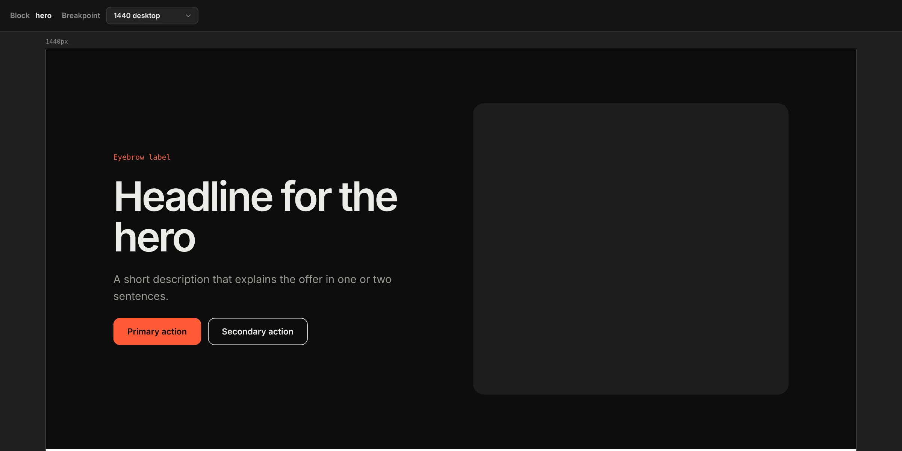
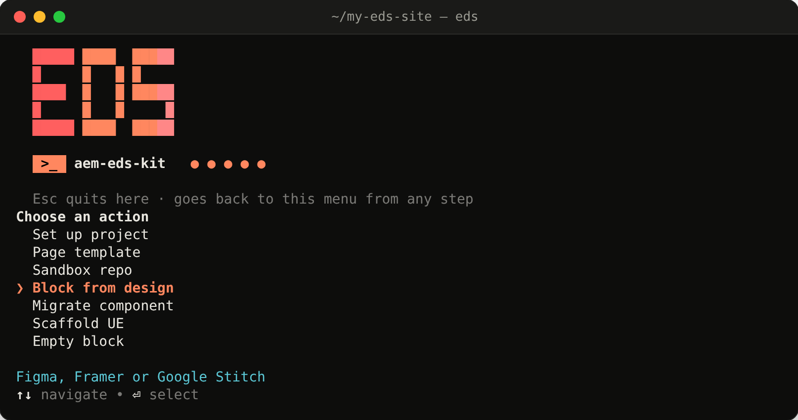

If you build sites on **AEM Edge Delivery Services (EDS)**, you know the loop: a designer sends a Figma link, and you rebuild the frame by hand as a block: `decorate()` JS, scoped CSS and a Universal Editor model. Then the next frame.

**[aem-eds-kit](https://www.npmjs.com/package/aem-eds-kit)** turns that into one command:

```bash
eds block from-design "<Figma frame link>" --name hero
```

This post walks through it step by step: setting up Figma access (REST or MCP), preparing the file, generating the block, and staying inside Figma's rate limits. At the end there's a reference of every option.


---

## How it works

```text
Figma frame
    │  read once (REST or MCP), cached
    ▼
design spec  ──►  prompt: EDS rules + your project's design tokens
                              │
                              ▼
          your AI agent (Claude Code, Cursor or Codex)
                              │
                              ▼
 blocks/hero/  hero.js · hero.css · _hero.json (UE model) · _hero.preview.html
```

- **`eds` reads the frame**: layout, Auto Layout, text styles, Variables, variants and frame widths.
- **It builds a prompt**: how EDS markup looks, how to write `decorate()`, which of the 17 Universal Editor field types fits each layer, and your project's design tokens from `styles/styles.css`.
- **The AI coding agent you already use writes the block**: `eds` doesn't ship a model of its own.

---

## Step 1: Install

You need **Node.js 20+** and **Claude Code, Cursor or Codex**.

```bash
npm install -g aem-eds-kit@latest
```

You also need an EDS project. If you don't have one, clone Adobe's latest boilerplate (no GitHub login needed):

```bash
eds new my-site       # pick: Document Authoring / DA, Universal Editor, or Commerce
cd my-site
eds init              # set it up for your authoring model
```

---

## Step 2: Connect to Figma (REST or MCP)

Figma draws designs on a canvas, not in HTML, so the frame has to come from Figma itself. There are two ways in. **You only need one.**

| | **REST** (recommended) | **MCP** |
|---|---|---|
| Who reads the design | `eds` itself, over Figma's REST API | Your AI agent, through its Figma MCP server |
| You need | A Figma personal access token | Your agent connected to Figma's MCP server |
| Works with a local model (Ollama, oMLX) | Yes | No |
| Cost per block | 1 REST call, then cached | 1 MCP call, then cached |

### Option A: REST (a token)

1. In Figma, open **Settings → Security → Personal access tokens** and generate a token with **File content: read** (`file_content:read`).
2. Give it to `eds`, either as an environment variable:

   ```bash
   export FIGMA_TOKEN=figd_your_token
   ```

   or once in `~/.eds/config.json`:

   ```json
   { "figma": { "token": "figd_your_token" } }
   ```

That's it. With a token set, `eds` fetches the frame itself and embeds a compact spec in the prompt. Treat the token like a password and keep it out of your repo.

### Option B: MCP (no token)

Connect your agent to Figma's MCP server: Figma's remote server, or the local one built into the Figma desktop app (turn it on in Dev Mode; it runs at `http://127.0.0.1:3845/mcp`). Not sure what your agent needs? Run:

```bash
eds figma setup
```

It detects your agent (Claude Code, Cursor or Codex), checks whether Figma MCP is connected, prints the exact command or config to add it if not, and saves your choice.

With MCP, the agent makes **one** `get_design_context` call per block, and `eds` caches the result. If you have a token but want MCP for a run, add `--mcp`.

---

## Step 3: Prepare the frame

`eds` reads what's in the file, so a tidy frame gives a better block:

- **One top-level frame per block**, named after the block in kebab-case: `hero`, `cards`, `cta-banner`.
- **Auto Layout everywhere.** It becomes flex / grid with the right gaps and padding.
- **Layers named by role**, not looks: `title`, `description`, `image`, `cta`. These become the Universal Editor fields.
- **Colours, spacing, radii and font sizes bound to Variables** (`color/brand`, `spacing/m`). They map to CSS custom properties.
- **Variants for block variations** (`Theme=dark`, `Layout=image-left`) and boolean properties for optional parts.
- **The same block at 2–3 widths** (e.g. 390 / 768 / 1440). `eds` records the frame widths and uses them as the preview breakpoints.

---

## Step 4: Generate the block

In Figma, right-click the frame → **Copy link to selection**. Then:

```bash
eds block from-design "https://www.figma.com/design/<file>/<name>?node-id=12-345" --name hero
```

What happens:

1. `eds` reads the frame (REST or MCP) and caches it.
2. It builds the prompt and hands it to your agent. You see a live log.
3. It checks the result: the files exist, `decorate()` is exported, the CSS is scoped to the block, and the Universal Editor model is valid.
4. You get a menu: **Refine** (describe a change for another pass), **Open live preview**, or **Finish**.

The result:

```text
blocks/hero/
├── hero.js              # decorate(block)
├── hero.css             # styles, scoped to .hero
├── _hero.json           # Universal Editor model: one field per layer
├── _hero.preview.html   # sample content in real EDS markup
└── .eds-meta.json       # the Figma source and the frame widths
```

The block ships with **placeholder copy and image slots** until authors fill them in. The layout, spacing, type, colours and backgrounds come from the frame.

Want to see what would be sent first? `--dry-run` builds the prompt without running the agent.

---

## Step 5: Preview and check

```bash
eds block preview hero     # the block at the frame widths, live reload
eds block check hero       # accessibility: alt text, image sizes, link names…
eds block test hero        # visual regression against a saved baseline
```



With a REST token, `eds block test hero --design` also compares the rendered block against the frame's image from Figma.

The block is just files in `blocks/`, so `aem up` shows it in a real page.

---

## Step 6: Mind Figma's limits

Figma counts both REST and MCP calls, and the limit depends on **the plan that owns the file**, not on your seat in some other team:

| | Starter | Professional | Organization | Enterprise |
|---|---|---|---|---|
| REST, Dev / Full seat | 20 / month | 10 / min | 15 / min | 20 / min |
| MCP, Dev / Full seat | 20 / month | 200 / day | 200 / day | 600 / day |
| View / Collab seat (both) | 20 / month | 20 / month | 20 / month | 20 / month |

`eds` keeps you inside them:

- **One call per block**, then a cache, so refine passes and retries are free. `--refresh` reads the frame again.
- **REST calls are paced per minute**, even when you generate several blocks in parallel (`figma.restPerMinute`, default 10; use 15 on Organization, 20 on Enterprise).
- **A short `429` is waited out.**
- **A plan cap stops the run** and tells you when the limit resets. `eds` never silently falls back to spending your MCP budget.

**On a Starter plan**, the cheapest route is to export the frame (right-click → **Export** → PNG or SVG) and pass the file. That uses no Figma calls at all:

```bash
eds block from-design ./hero.svg --name hero
```

An SVG keeps the text and shapes readable; a PNG works too.

---

## Going further with the block

Once the block is generated, a few commands build on it:

```bash
eds model add hero teaser              # add reusable field groups to the UE model (image, cta, teaser…)
eds track block hero                   # dataLayer tracking: clicks and form submits
eds schema block hero --type Article   # JSON-LD structured data for SEO
eds ue check                           # which blocks are editable in the Universal Editor
eds ue open /                          # open a page in the Universal Editor
eds template new home --blocks header,hero,footer   # a page made of your blocks
eds preview /home && eds publish /home              # to *.aem.page, then *.aem.live
```

---

## Free: no agent, no MCP, no Figma calls

Generating from a design needs an AI agent. Everything else in `eds` is deterministic: plain code generation that runs offline and costs nothing.

```bash
eds new my-site                      # clone the latest EDS boilerplate
eds init                             # set it up for your authoring model
eds block create hero                # an empty block: hero.js, hero.css and a UE model
eds scaffold ue                      # Universal Editor config (component definitions, models, filters)
eds scaffold blocks                  # the standard EDS blocks, ready for UE
eds scaffold helpers                 # shared helper functions
eds model add hero teaser            # add ready-made field groups to a block's UE model
eds schema block hero --type Article # JSON-LD structured data
eds track block hero                 # dataLayer click and form tracking
eds migrate component <dir>          # a classic AEM component → block + UE model
eds template new home --blocks hero  # a page made of your blocks
eds block check                      # accessibility and content checks
eds block test                       # visual regression
eds doctor                           # project health; also eds audit loading / security
```

And for designs, two ways to spend nothing on Figma or a cloud model:

- `eds block from-design "<frame link>" --dry-run` (or `--agent none`) saves the full prompt to a file without calling any agent. Paste it into any AI chat you like.
- Export the frame as PNG or SVG (no Figma calls), then generate with a local model: `--agent ollama`.

---

## All the options

### `eds block from-design`

| Option | What it does |
|---|---|
| `--name <name>` | Block name (otherwise taken from the frame) |
| `--mcp` | Use Figma MCP even when a REST token is set |
| `--refresh` | Read the frame again instead of using the cache |
| `--screenshot` | Add one MCP screenshot call for a pixel check (costs a call) |
| `--source <type>` | Where content comes from: `document` (default), `ue`, `cf` (Content Fragment) or `mixed`; `cf` / `mixed` default to the `sonnet` model |
| `--no-ue-model` | Skip the Universal Editor model |
| `--widths <list>` | Preview breakpoints, e.g. `390,768,1440`, if the file has only one frame width |
| `--agent <type>` | `claude`, `cursor`, `codex`, `ollama`, `omlx`, `local`, or `none` (just save the prompt) |
| `--model <name>` | The model to use, e.g. `sonnet`, or a local one like `qwen2.5-coder:14b` |
| `--dry-run` | Only build and show the prompt, don't run the agent |
| `--serve` | Start the live preview right after generating (non-interactive runs) |
| `--yes` | No questions, use defaults |

With no arguments, `eds block from-design` runs a step-by-step wizard.

### Preview and checks

| Command | Options |
|---|---|
| `eds block preview [name]` | `--widths <list>` breakpoints · `--port <port>` · `--no-open` don't open the browser. No name: a gallery of all blocks |
| `eds block test [name]` | `--update` save new baselines · `--threshold <ratio>` allowed change (default `0.01` = 1%) · `--design` compare against the Figma frame image (needs a token) · `--widths` · `--port` |
| `eds block check [name]` | `--strict` fail on warnings too · `--widths` · `--port` |

No name in `test` / `check` means all blocks. Both exit non-zero on failure, so they fit in CI.

### Configuration (`~/.eds/config.json`)

```json
{
  "agent": "claude",
  "model": "sonnet",
  "figma": { "token": "figd_…", "restPerMinute": 10 }
}
```

| Key | What it does |
|---|---|
| `agent` | Default agent, so you can drop `--agent` |
| `model` | Default model (the built-in default is the fastest, Haiku; `sonnet` is more faithful) |
| `figma.token` | REST token; the `FIGMA_TOKEN` env variable works too |
| `figma.restPerMinute` | REST calls per minute across parallel runs: 10 (Professional), 15 (Organization), 20 (Enterprise) |

Priority: command-line flags → env variables → `.edsrc.json` in the project → `~/.eds/config.json`.

### Global flags (any command)

| Flag | What it does |
|---|---|
| `--verbose` | Debug output |
| `--quiet` | Errors only |
| `--json` | JSON output (`doctor`, `audit loading`, `audit security`, `block list`) |
| `--no-color` | No colours (also respects `NO_COLOR`) |

Or skip the flags entirely: type `eds` and pick from the menu (arrows, Enter, Esc to go back).



---

The same CLI also takes Framer and Google Stitch pages, migrates classic AEM components into EDS blocks, and runs on a local model (Ollama, oMLX). All of that is in the **[docs](https://piotrgodycki.github.io/aem-eds-kit/docs.html)**. Code: **[GitHub](https://github.com/piotrgodycki/aem-eds-kit)** (MIT).

Questions or ideas? Tell me in the comments.

*aem-eds-kit is an independent open-source project, not affiliated with Adobe or Figma.*
