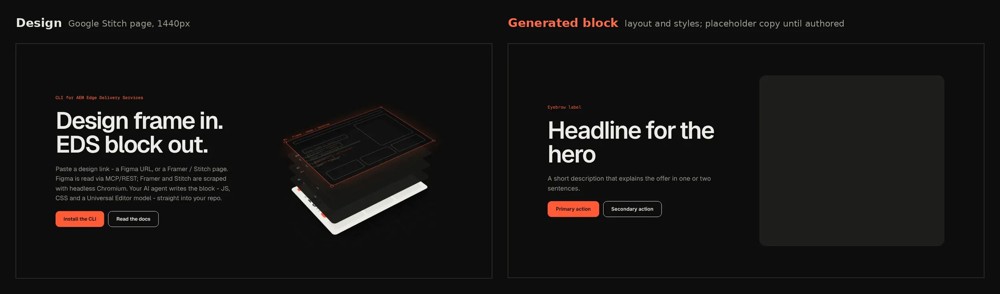
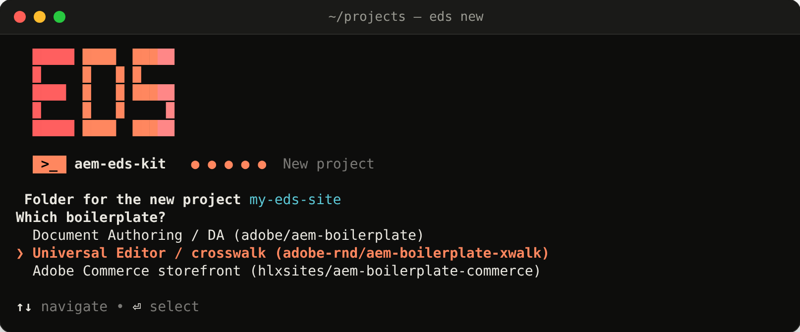
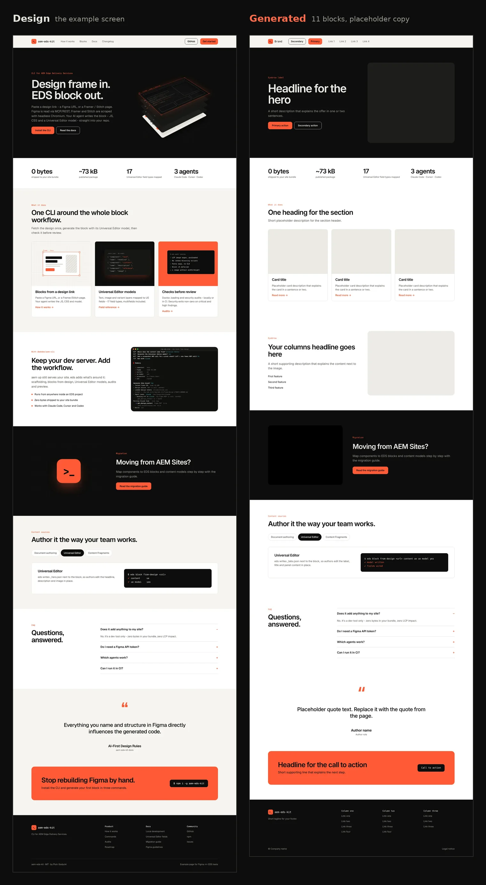

If you build sites on **AEM Edge Delivery Services (EDS)**, you know the loop: a designer sends a Figma frame, a Framer page or a Google Stitch screen, and you rebuild it by hand as a block: `decorate()` JS, scoped CSS and a Universal Editor model.

**[aem-eds-kit](https://www.npmjs.com/package/aem-eds-kit)** turns that into one command. Paste the design link, get the block:

```bash
eds block from-design "<Figma frame, Framer or Stitch link>" --name hero
```

This post shows how to do it from each of the three, step by step.



---

## How it works

```text
Figma frame / Framer page / Stitch screen
        │  read once, cached
        ▼
  design spec  ──►  prompt: EDS rules + your project's design tokens
                                │
                                ▼
            your AI agent (Claude Code, Cursor or Codex)
                                │
                                ▼
   blocks/hero/  hero.js · hero.css · _hero.json (UE model) · _hero.preview.html
```

The three sources are read differently:

| | How `eds` reads it | What you need |
|---|---|---|
| **Figma** | Figma's REST API, or your agent's Figma MCP server | A token (REST) or Figma MCP in your agent |
| **Framer** | Opens the page in headless Chromium and reads the computed layout, fonts, colours and sizes | Nothing, just the link |
| **Google Stitch** | The same, signed in to your Google account | One manual sign-in (`--auth`) |

Whichever you use, the result is the same:

```text
blocks/hero/
├── hero.js              # decorate(block)
├── hero.css             # styles, scoped to .hero
├── _hero.json           # Universal Editor model
├── _hero.preview.html   # sample content in real EDS markup
└── .eds-meta.json       # design source and its frame widths
```

`eds` builds the prompt; the AI coding agent you already use writes the code. The block ships with **placeholder copy and image slots** until authors fill them in. The layout, spacing, type, colours and backgrounds come from the design.

---

## Setup (once)

You need **Node.js 20+** and **Claude Code, Cursor or Codex**.

```bash
npm install -g aem-eds-kit@latest
npx playwright install chromium      # the headless browser used for Framer and Stitch
```

You also need an EDS project. If you don't have one, clone Adobe's latest boilerplate (no GitHub login needed):

```bash
eds new my-site       # pick: Document Authoring / DA, Universal Editor, or Commerce
cd my-site
eds init              # set it up for your authoring model
```



---

## 1. From Figma

Figma draws designs on a canvas, not in HTML, so `eds` can't scrape it. It reads the frame one of two ways. You only need **one**.

| | **REST** (recommended) | **MCP** |
|---|---|---|
| Who reads the design | `eds` itself, over Figma's REST API | Your AI agent, through its Figma MCP server |
| You need | A Figma personal access token | Your agent connected to Figma's MCP server |
| Cost per block | 1 REST call, then cached | 1 MCP call, then cached |

### Option A: REST (a token)

1. In Figma, open **Settings → Security → Personal access tokens** and generate a token with **File content: read** (`file_content:read`).
2. Give it to `eds`, either as an environment variable:

   ```bash
   export FIGMA_TOKEN=figd_your_token
   ```

   or once in `~/.eds/config.json`:

   ```json
   { "figma": { "token": "figd_your_token" } }
   ```

3. In Figma, right-click the frame → **Copy link to selection**, then run:

   ```bash
   eds block from-design "https://www.figma.com/design/<file>/<name>?node-id=12-345" --name hero
   ```

With a token set, `eds` uses REST; add `--mcp` to force MCP instead. Treat the token like a password and keep it out of your repo.

### Option B: MCP (no token)

1. Connect your agent to Figma's MCP server: Figma's remote server, or the local one built into the Figma desktop app (turn it on in Dev Mode; it runs at `http://127.0.0.1:3845/mcp`). Not sure what your agent needs? Run:

   ```bash
   eds figma setup
   ```

   It detects your agent, checks whether Figma MCP is connected, prints the exact command or config to add it if not, and saves your choice.

2. Run the same command, with no token set:

   ```bash
   eds block from-design "<frame link>" --name hero
   ```

   The agent makes **one** `get_design_context` call, and `eds` caches the result.

### Mind Figma's limits

Figma counts both paths, and the limit depends on **the plan that owns the file**:

| | Starter | Professional | Organization | Enterprise |
|---|---|---|---|---|
| REST, Dev / Full seat | 20 / month | 10 / min | 15 / min | 20 / min |
| MCP, Dev / Full seat | 20 / month | 200 / day | 200 / day | 600 / day |
| View / Collab seat (both) | 20 / month | 20 / month | 20 / month | 20 / month |

`eds` keeps you inside them:

- one call per block, cached, so refine passes and retries are free (`--refresh` reads again);
- REST calls are paced per minute, even across parallel runs (`figma.restPerMinute`, default 10);
- a short `429` is waited out;
- when you hit a plan cap, it stops and tells you when the limit resets. It never silently switches to your MCP budget.

**On a Starter plan**, the cheapest route is to export the frame (right-click → **Export** → PNG or SVG) and pass the file. That uses no Figma calls at all:

```bash
eds block from-design ./hero.png --name hero
```

**Tips for a better result:** one top-level frame per block, named after the block (`hero`, `cards`); Auto Layout; layers named by role (`title`, `image`, `cta`); colours and sizes bound to Variables. Variants (`Theme=dark`) become block options.

---

## 2. From Framer

Framer publishes real HTML, so there's no token and no API.

1. Publish the page in Framer (or use its preview link) and copy the URL.
2. Run:

   ```bash
   eds block from-design "https://your-site.framer.website/" --name hero
   ```

`eds` recognises the Framer host, opens the page in headless Chromium and reads the section that matches `--name`. On a page with several sections, run it once per block:

```bash
eds block from-design "https://your-site.framer.website/" --name cards
eds block from-design "https://your-site.framer.website/" --name footer
```

The page is read once and cached, so the next blocks start faster. A page behind a password? Add `--auth` (see Stitch below).

---

## 3. From Google Stitch

A Stitch project sits behind your Google login, so an anonymous read only sees the sign-in screen. Sign in once:

1. Copy the link to your Stitch project.
2. Run it with `--auth`:

   ```bash
   eds block from-design "<stitch-project-link>" --name hero --auth
   ```

3. A real browser window opens. Sign in by hand, then press Enter in the terminal.

The session is saved owner-only in `~/.eds/auth/` (it's a secret and never goes into your repo), and every later run reuses it. Use `--auth-refresh` to sign in again.

---

## No account at hand? Try the example page

The project has an example page built from the same design as its Figma example file: **[piotrgodycki.github.io/aem-eds-kit/example](https://piotrgodycki.github.io/aem-eds-kit/example/)**. `eds` reads it exactly like a Framer or Stitch page, so you can see the whole flow without signing up anywhere:

```bash
eds block from-design https://piotrgodycki.github.io/aem-eds-kit/example/ --name hero
```

It has 11 sections (header, hero, stats, cards, columns, teaser, tabs, cta-banner, quote, accordion, footer). Generate all of them and you get the whole screen:



---

## After generating: refine, preview, check

When the agent finishes, `eds` checks the files (they exist, `decorate()` is exported, the CSS is scoped, the UE model is valid) and offers a menu: **Refine** (describe a change for another pass), **Open live preview**, or **Finish**.

```bash
eds block preview hero     # the block at the design's own widths, live reload
eds block check hero       # accessibility: alt text, image sizes, link names…
eds block test hero        # visual regression against a saved baseline
```


The block is just files in `blocks/`, so `aem up` shows it in a real page.

## The options you'll use most

| Option | What it does |
|---|---|
| `--name <name>` | Block name; on a page with many sections, also which section to build |
| `--provider <type>` | Force the source: `figma`, `framer`, `stitch` or `web` (else detected from the link) |
| `--auth` / `--auth-refresh` | Sign in once for a gated page / sign in again |
| `--mcp` | Use Figma MCP even when a REST token is set |
| `--source <type>` | Where content comes from: `document`, `ue`, `cf` (Content Fragment) or `mixed` |
| `--agent <type>` | `claude`, `cursor`, `codex`, or `none` (just save the prompt) |
| `--model <name>` | The model to use, e.g. `sonnet` (more faithful than the default) |
| `--dry-run` | Only build and show the prompt, no agent |
| `--refresh` | Read the design again instead of using the cache |
| `--yes` | No questions |

Run `eds block from-design` with no arguments for a step-by-step wizard, or just `eds` for a menu with everything.

---

The same CLI also migrates classic AEM components into EDS blocks, runs block generation on a local model (Ollama, oMLX), and previews and publishes pages. All of that is in the **[docs](https://piotrgodycki.github.io/aem-eds-kit/docs.html)**. Code: **[GitHub](https://github.com/piotrgodycki/aem-eds-kit)** (MIT).

Questions or ideas? Tell me in the comments.

*aem-eds-kit is an independent open-source project, not affiliated with Adobe, Figma, Framer or Google.*
